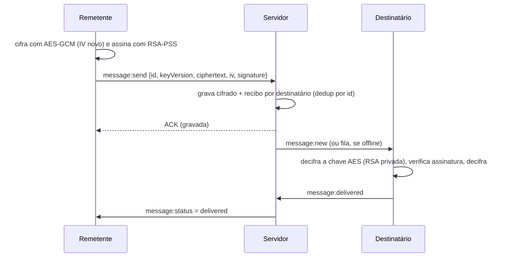

# Chat criptografado

Chat web com criptografia ponta a ponta (E2EE) em que **o servidor nunca vê o conteúdo das mensagens**. Suporta conversas de 2 pessoas e grupos de 3 ou mais, com entrega a destinatários offline e tratamento de quedas de conexão.

## Sumário

1. [Objetivo](#1-objetivo)
2. [Status do projeto](#2-status-do-projeto)
3. [Arquitetura de segurança](#3-arquitetura-de-segurança)
4. [Estrutura do repositório](#4-estrutura-do-repositório)
5. [Como executar](#5-como-executar)
6. [Roteiro de demonstração](#6-roteiro-de-demonstração)
7. [Equipe](#7-equipe)

---

## 1. Objetivo

Trabalho acadêmico para construir um chat seguro, aplicando criptografia simétrica e assimétrica em um sistema distribuído real.

**Requisitos obrigatórios**

- Cadastro/login e geração das chaves do usuário
- Lista de contatos/usuários
- Conversa com 2 pessoas e com 3 ou mais (grupo), no mesmo fluxo
- Mensagens cifradas com **AES** e chave de sessão cifrada com **RSA**
- Assinatura digital das mensagens (autenticidade) e verificação de integridade
- Entrega mesmo com destinatário offline
- Tratamento de quedas (remetente, destinatário, servidor, conexão)
- Grupo: adicionar, remover e sair, com troca de chave

**Critérios de conclusão**

- Duas pessoas conversam e o banco mostra apenas bytes ilegíveis
- Três ou mais pessoas conversam na mesma conversa
- Membro removido não consegue ler mensagens novas
- Usuário offline recebe tudo ao reconectar, na ordem certa e sem duplicatas
- Mensagem adulterada é detectada e sinalizada
- Queda de conexão no meio da conversa é recuperada sem perda de mensagens

## 2. Status do projeto

| Parte | Responsável | Status |
|---|---|---|
| Contrato (`shared/`) | todos | ✅ tipos REST e eventos Socket.IO |
| Backend (`backend/`) | Pessoa 2 | ✅ implementado, com testes de integração |
| Criptografia (`crypto.ts`) | Pessoa 1 | ⏳ em desenvolvimento |
| Frontend | Pessoa 3 | ⏳ em desenvolvimento |

> Atualize esta tabela conforme as partes forem integradas.

## 3. Arquitetura de segurança

### 3.1 Visão geral

```
 Navegador A                      Servidor                       Navegador B
┌────────────────┐         ┌───────────────────┐          ┌────────────────┐
│ chave privada  │         │ chaves públicas   │          │ chave privada  │
│ (IndexedDB)    │         │ chaves AES cifradas│         │ (IndexedDB)    │
│ cifra / decifra│ ──────► │ ciphertext + iv   │ ───────► │ cifra / decifra│
│ assina/verifica│  HTTPS  │ assinaturas       │  WSS     │ assina/verifica│
└────────────────┘         │ (só bytes opacos) │          └────────────────┘
                           └───────────────────┘
```

Toda a criptografia roda no **navegador**, com a Web Crypto API nativa. O servidor autentica usuários, armazena e roteia dados opacos, mas não possui nenhuma chave capaz de decifrá-los.

### 3.2 Primitivas

| Finalidade | Algoritmo |
|---|---|
| Cifrar mensagens | AES-256-GCM (IV aleatório de 12 bytes, único por mensagem) |
| Proteger a chave AES de sessão | RSA-OAEP |
| Assinatura das mensagens | RSA-PSS |
| Autenticação na API | JWT (HS256) |
| Senha no servidor | bcrypt |
| Formato das chaves públicas | SPKI em base64 (RSA ≥ 2048 bits) |

### 3.3 Hierarquia de chaves

1. **Par RSA do usuário.** Gerado no navegador no cadastro. A chave privada fica no IndexedDB e **nunca é enviada ao servidor**. Só a pública é registrada.
2. **Chave AES de sessão (por conversa e por versão).** Gerada pelo cliente que cria a conversa. Uma cópia é cifrada com a RSA pública de **cada participante**, e o servidor guarda uma linha por participante (`session_keys`).
3. **Versão da chave (`key_version`).** Cada mudança de membros gera uma nova chave AES e incrementa a versão. Cada mensagem registra com qual versão foi cifrada.

### 3.4 Fluxos

**Cadastro**

1. O cliente gera o par RSA e guarda a privada localmente.
2. Envia `username`, `password` e a chave pública. O servidor valida que é RSA SPKI com pelo menos 2048 bits.

**Nova conversa (2 ou mais pessoas)**

1. O criador busca as chaves públicas dos participantes.
2. Gera a chave AES, cifra uma cópia para cada participante (inclusive para si) e envia tudo em uma única requisição.
3. O servidor grava conversa, participantes e chaves **em uma transação atômica** e rejeita conjuntos de chaves que não cubram exatamente os membros.

**Envio e recebimento**



**Entrada, saída ou remoção de membro**

- Gera-se nova chave AES (`key_version + 1`) e ela é distribuída **somente a quem permanece**.
- Quem saiu ou foi removido não recebe a chave nova, então não decifra nada posterior. O servidor também recusa envios dele.
- Um novo membro recebe apenas a chave nova e não acessa o histórico anterior.
- Adicionar alguém a uma conversa de 2 cria uma **nova conversa** com todos, com chave nova. O histórico antigo permanece na original.

### 3.5 O que o servidor vê e o que não vê

| O servidor **não** vê | O servidor **vê** |
|---|---|
| Conteúdo das mensagens | Quem conversa com quem e quando |
| Chaves AES em claro | Tamanho aproximado das mensagens |
| Chaves privadas | Presença online/offline |
| | Chaves públicas e hash da senha |

### 3.6 Integridade, autenticidade e falhas

| Situação | Tratamento |
|---|---|
| Mensagem adulterada | A tag do GCM falha ou a assinatura é inválida, e a UI mostra aviso |
| Duplicata | `message_id` (UUID do cliente) com deduplicação no servidor |
| Destinatário offline | Servidor guarda cifrado e reentrega ao reconectar, em ordem |
| Conexão cai sem ACK | O cliente reenvia com o mesmo `message_id` |
| Chave nova ainda não recebida | O cliente guarda a mensagem, pede a chave e decifra depois |
| Rotação concorrente | O servidor rejeita com `STALE_KEY_VERSION`, e o cliente refaz com a versão atual |
| Mensagem com chave antiga | O servidor rejeita com `STALE_KEY`, e o cliente recifra com a versão nova |
| Distribuição de chaves interrompida | Transação atômica, sem estado parcial |

### 3.7 Limitações conhecidas

Decisões conscientes de escopo, úteis para a discussão no trabalho:

- **Confiança nas chaves públicas.** O servidor distribui as chaves públicas e, em tese, poderia substituí-las (ataque *man-in-the-middle*). A mitigação prevista é a conferência por **fingerprint** da chave pública (item extra).
- **Sem *forward secrecy* por mensagem.** Quem obtiver uma chave AES de sessão decifra todas as mensagens daquela versão. A rotação limita o dano só nas mudanças de membros.
- **Chave privada no navegador.** Um ataque XSS poderia usá-la, e perder o IndexedDB significa perder o acesso às mensagens. Não há sincronização entre dispositivos.
- **Membro removido** mantém o que já recebeu e decifrou antes da remoção.
- **Metadados não são protegidos** (ver 3.5).
- **O servidor não verifica as assinaturas**, só as armazena. A verificação é feita pelo destinatário.
- **Sem limitação de tentativas** no login (rate limit).

## 4. Estrutura do repositório

```
.
├── shared/            # contrato: tipos TS, eventos do socket
│   └── types.ts
├── backend/           # API REST + Socket.IO + SQLite
│   ├── src/
│   │   ├── routes/    # auth, users, conversations
│   │   ├── services/  # regras de conversas/chaves e mensagens
│   │   ├── realtime.ts
│   │   └── db.ts      # schema
│   └── test/          # testes de integração
├── frontend/          # React + TypeScript + Vite
└── README.md
```

Decisões técnicas: React + Vite no frontend; Node + TypeScript + Express + Socket.IO no backend; SQLite (better-sqlite3); Web Crypto API nativa na criptografia.

## 5. Como executar

### Pré-requisitos

- Node.js 20 ou superior e npm
- Navegador moderno (com Web Crypto API e IndexedDB)

### Backend

```bash
cd backend
npm install

# variáveis de ambiente (veja .env.example)
export JWT_SECRET="troque-por-um-segredo-longo-e-aleatorio"
export CORS_ORIGIN="http://localhost:5173"   # origem do frontend
# opcionais: PORT=3000  DB_FILE=./data/chat.db

npm run dev      # http://localhost:3000, com recarga automática
```

Em produção, defina `NODE_ENV=production` (o `JWT_SECRET` passa a ser obrigatório) e use `npm start`.

### Testes e verificação de tipos

```bash
cd backend
npm test           # integração: offline, ACK, duplicatas, rotação de chave
npm run typecheck
```

### Frontend

```bash
cd frontend
npm install
npm run dev        # http://localhost:5173
```

> O frontend ainda está em desenvolvimento. Confirme os comandos acima no `package.json` da pasta quando ele for integrado. Ele deve apontar para o backend em `http://localhost:3000`.

### Referência da API

As rotas REST e os eventos Socket.IO estão documentados em [`backend/README.md`](backend/README.md), e os tipos em [`shared/types.ts`](shared/types.ts).

## 6. Roteiro de demonstração

1. Cadastrar dois usuários e iniciar uma conversa.
2. Mostrar que o servidor só vê ciphertext:
   - na aba de rede do navegador, e
   - no banco:
     ```bash
     sqlite3 backend/data/chat.db "SELECT id, key_version, ciphertext, iv FROM messages;"
     ```
3. Derrubar a conexão de um cliente no meio e mostrar a entrega ao reconectar.
4. Criar um grupo com 3 pessoas, remover uma e mostrar a rotação de chave.
5. Alterar uma mensagem no banco e mostrar o aviso de adulteração.

## 7. Equipe

| Pessoa | Papel | Responsável |
|---|---|---|
| Pessoa 1 | Criptografia | _(preencher nome)_ |
| Pessoa 2 | Backend | _(preencher nome)_ |
| Pessoa 3 | Frontend | _(preencher nome)_ |
